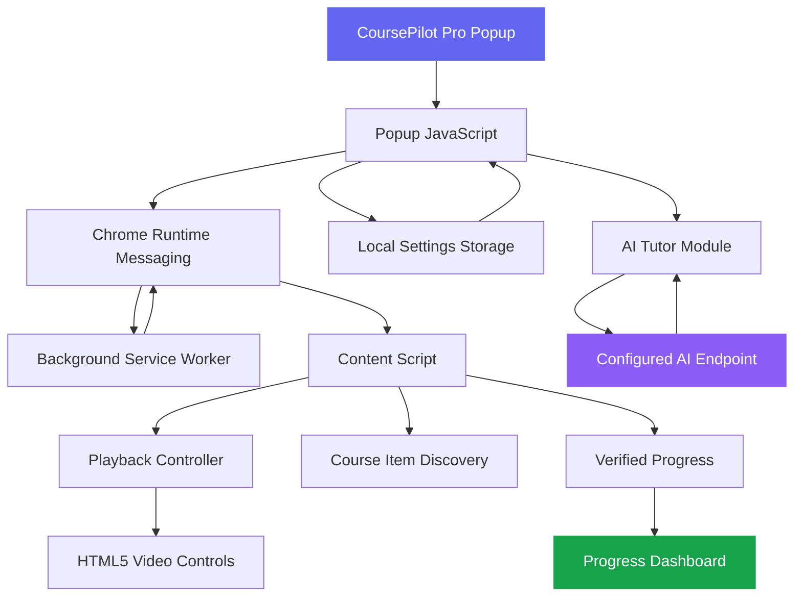
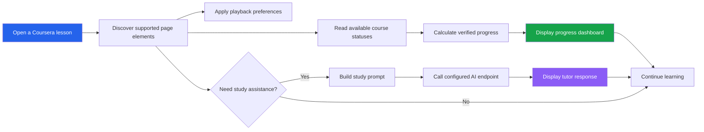
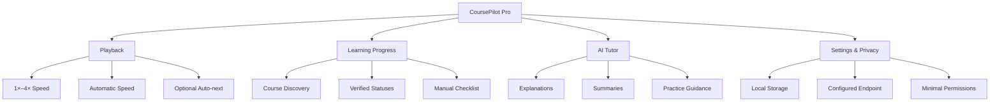

# CoursePilot Pro

<p align="center">
  
  
  
</p>

<p align="center">
  <b>A smarter learning companion for Coursera.</b><br/>
  Control playback, track verified learning progress, organize course activity, and study with an optional AI-powered tutor.
</p>

<p align="center">
  <a href="#-features">Features</a> •
  <a href="#-architecture">Architecture</a> •
  <a href="#-installation">Installation</a> •
  <a href="#-configuration">Configuration</a> •
  <a href="#-testing">Testing</a> •
  <a href="#-security--privacy">Privacy</a>
</p>

---

## Overview

**CoursePilot Pro** is an original Chrome extension built with Manifest V3 to improve the Coursera learning experience through playback controls, transparent progress tracking, course item discovery, and an optional Gemini-compatible study assistant.

The project combines a lightweight browser interface with a modular JavaScript architecture, local settings storage, and a service worker.

### Highlights

- **Smart playback:** Choose playback speeds from 1× to 4× on compatible HTML5 videos.
- **Automatic speed control:** Apply your preferred speed to newly discovered videos when enabled.
- **Auto-next:** Move to the next lesson when an identifiable next-lesson control is available and the feature is enabled.
- **Progress dashboard:** Calculate progress from verified statuses and manually confirmed checklist items.
- **AI Tutor:** Get explanations, summaries, conceptual hints, and guided practice walkthroughs.
- **Privacy-first design:** Store settings locally and request AI assistance only when explicitly invoked and configured.

## Technology Stack

<p align="center">
  <a href="https://developer.mozilla.org/en-US/docs/Web/JavaScript">
    
  </a>
  <a href="https://developer.mozilla.org/en-US/docs/Web/HTML">
    
  </a>
  <a href="https://developer.mozilla.org/en-US/docs/Web/CSS">
    
  </a>
  <a href="https://nodejs.org/">
    
  </a>
  <a href="https://git-scm.com/">
    
  </a>
  <a href="https://github.com/">
    
  </a>
</p>

<p align="center">
  
  
  
  
</p>

| Technology | Purpose |
|---|---|
| JavaScript | Extension logic and interactive behavior |
| HTML5 | Popup interface and document structure |
| CSS3 | Styling, themes, and dashboard presentation |
| Chrome Extension APIs | Tabs, storage, runtime messaging, and content scripts |
| Manifest V3 | Extension configuration and security model |
| Node.js | Running automated tests and project checks |
| Gemini-compatible API | Optional AI study assistance through a configured endpoint |
| Git and GitHub | Version control and project collaboration |

*The icons and stack above reflect the technologies described in the project documentation. Update them if your actual source code uses additional technologies.*

---

## Features

| Feature | Description | Availability |
|---|---|---|
| Playback speed | Select supported speeds from 1× to 4× | Implemented |
| Automatic speed | Apply saved speed to newly discovered videos | Optional |
| Auto-next | Activate an identifiable next-lesson control | Optional |
| Course discovery | Discover course items using supported page information | Implemented |
| Progress tracking | Use verified statuses and manual checklist confirmations | Implemented |
| AI Tutor | Explain concepts, summarize notes, and guide practice | Requires provider configuration |
| Dark/light theme | Switch between interface themes | Implemented |
| Local settings | Persist preferences using Chrome local storage | Implemented |
| Manifest V3 | Use a modern Chrome extension architecture | Implemented |

Feature availability can depend on Coursera's changing interface and the structure of an individual lesson page.

### Playback Controls

CoursePilot Pro provides a simple way to control supported HTML5 video playback.

- Choose a playback speed between 1× and 4×.
- Optionally apply your preferred speed automatically.
- Apply settings to newly discovered video elements.
- Use auto-next only when enabled and a recognizable next-lesson control is present.

Playback behavior remains subject to the page's player implementation and normal browser restrictions.

### Learning Progress Dashboard

The extension distinguishes verified completion from manually confirmed progress.

```text
Course Progress
├── Verified completed items
├── Manually confirmed checklist items
├── Discovered course items
└── Remaining learning activities
```

The dashboard must not treat an undiscovered item or an unknown status as completed.

### AI Tutor

The optional study assistant supports:

- Concept explanations
- Notes summarization
- Conceptual hints
- Practice problem walkthroughs

AI functionality requires a configured provider endpoint. It is not presented as a replacement for completing graded coursework independently.

---

## Architecture

CoursePilot Pro separates the popup interface, page interactions, playback controls, progress calculations, provider integration, and settings persistence into individual modules.



### Module Responsibilities

| Module | Responsibility |
|---|---|
| `src/popup.html` | Popup structure |
| `src/popup.css` | Dashboard styling and themes |
| `src/popup.js` | Popup interaction and user settings |
| `src/content.js` | Coursera page bridge and supported DOM interactions |
| `src/playback.js` | Video discovery, playback speed, and auto-next |
| `src/progress.js` | Status normalization and progress calculations |
| `src/gemini.js` | AI provider abstraction and study prompt construction |
| `src/storage.js` | Local settings persistence |
| `src/background.js` | Manifest V3 service worker |
| `tests/test.js` | Automated test suite |

The exact responsibilities and filenames should match the modules present in your current repository.

### Learning Workflow



---

## Project Structure

```text
CoursePilot-Pro/
├── manifest.json
├── README.md
├── LICENSE
├── package.json
│
├── src/
│   ├── popup.html
│   ├── popup.css
│   ├── popup.js
│   ├── content.js
│   ├── playback.js
│   ├── progress.js
│   ├── gemini.js
│   ├── storage.js
│   └── background.js
│
└── tests/
    └── test.js
```

This is the documented logical structure; retain any additional files and directories already present in your project.

---

## Installation

### Prerequisites

- Google Chrome or a compatible Chromium-based browser
- The CoursePilot Pro project files
- Node.js and npm for running the test suite

### Step 1: Download the Project

Download and extract the project ZIP, or clone your repository:

```bash
git clone YOUR_REPOSITORY_URL
cd CoursePilot-Pro
```

Replace `YOUR_REPOSITORY_URL` with your actual GitHub repository URL.

### Step 2: Install Dependencies

If the project has a `package.json` with dependencies, run:

```bash
npm install
```

If the project has no external dependencies, this step may not be necessary.

### Step 3: Open Chrome Extensions

Navigate to:

```text
chrome://extensions/
```

### Step 4: Enable Developer Mode

Turn on **Developer mode** in the top-right corner.

### Step 5: Load the Extension

1. Click **Load unpacked**.
2. Select the extracted `CoursePilot-Pro` folder.
3. Confirm that the extension appears in the extensions list.
4. Pin CoursePilot Pro to the Chrome toolbar.

### Step 6: Start Learning

1. Open a supported Coursera lesson.
2. Reload the page if the content script is not connected.
3. Click the CoursePilot Pro toolbar icon.
4. Configure playback preferences and available settings.
5. Configure an AI endpoint separately if you want to use the AI Tutor.

---

## Configuration

### Playback Settings

Select your preferred playback speed in the popup. Enable automatic speed application if you want newly discovered video elements to use that preference.

Auto-next should remain disabled unless you want the extension to activate a clearly identifiable next-lesson control.

### AI Tutor Configuration

CoursePilot Pro uses a provider module so that AI requests can be routed through an endpoint you control.

Example request:

```json
{
  "model": "gemini-2.5-flash",
  "mode": "explain",
  "prompt": "Explain the concept of gradient descent with an example."
}
```

Expected response:

```json
{
  "text": "Gradient descent is an optimization algorithm..."
}
```

These examples describe the documented interface contract, not a guarantee that a particular endpoint is deployed or available.

For a public release, use a backend proxy that:

- Keeps the Gemini API key on the server.
- Authenticates requests.
- Enforces rate limits.
- Validates request payloads.
- Limits prompt size and response size.
- Applies an appropriate logging and retention policy.

**Never commit a real API key, access token, or private credential to the extension repository.**

---

## Testing

CoursePilot Pro includes a Node.js-based automated test suite.

Run the tests:

```bash
npm test
```

Run the project checks:

```bash
npm run check
```

The documented test coverage includes:

- Status normalization
- Progress calculation
- Manual checklist merging
- Playback speed bounds
- Prompt safety wording
- Missing AI endpoint errors
- HTTP 429 rate-limit handling

These commands require the corresponding scripts to exist in `package.json`. A successful test run should be verified before adding a passing-test badge to the repository.

### Manual Testing Checklist

- [ ] The extension loads without manifest errors.
- [ ] The popup opens on a supported Coursera page.
- [ ] Playback speed changes work with compatible HTML5 video elements.
- [ ] Automatic speed application works after lesson navigation.
- [ ] Auto-next activates only when enabled and a valid control is found.
- [ ] Course item statuses are interpreted correctly.
- [ ] Unknown completion states are not counted as completed.
- [ ] Manual checklist confirmations persist as intended.
- [ ] Dark and light themes render correctly.
- [ ] The AI Tutor handles missing configuration gracefully.
- [ ] Rate-limit errors are handled without crashing the popup.
- [ ] No API credentials are exposed in packaged extension files.

---

## Progress and Feature Visualization

The following diagram summarizes the major functional areas of the project.



This is a functional overview, not a measured usage or performance chart. Real completion rates, time saved, and usage statistics should only be added when the extension actually collects reliable measurements for them.

---

## Security & Privacy

Privacy and transparency are core design principles.

- **Local settings:** Preferences are stored using `chrome.storage.local`.
- **No credential collection:** The extension does not ask for your Coursera password.
- **No fabricated completion:** Progress is based on supported page statuses or explicit manual checklist confirmations.
- **Explicit AI usage:** AI requests are made when the user invokes the AI Tutor and configures a provider endpoint.
- **No bundled API secret:** Provider credentials should remain server-side.
- **Limited scope:** The extension does not spoof document visibility or bypass browser and platform access controls.

Before distributing the extension, review the permissions declared in `manifest.json`, verify all network destinations, and document any additional data collection introduced by future features.

---

## Responsible Learning

CoursePilot Pro is designed to support learning productivity rather than misrepresent academic achievement.

It intentionally does not automatically answer, select, or submit active graded Coursera assessments. It does not fabricate completion records or claim that a lesson is complete when the status cannot be verified.

Users remain responsible for following their institution's and Coursera's applicable course policies.

---

## Troubleshooting

| Issue | Suggested action |
|---|---|
| Extension does not load | Check `manifest.json` and the Chrome extension error details |
| Popup does not connect | Reload the Coursera tab and reopen the popup |
| Playback speed has no effect | Verify that the lesson exposes a compatible HTML5 video element |
| Auto-next does not work | Check whether a supported next-lesson control is available |
| Progress looks incomplete | Verify the page status and confirm checklist items where appropriate |
| AI Tutor reports a configuration error | Verify the configured endpoint and response format |
| AI endpoint returns HTTP 429 | Apply rate limiting, retry controls, or appropriate backoff |
| Theme is not applied | Reopen the popup and inspect saved settings |

Coursera can change its page structure at any time, so selectors and supported interactions may require maintenance.

---

## Roadmap

Potential future enhancements include:

- [ ] Interactive progress charts based on verified learning records
- [ ] Course-level progress history
- [ ] Improved keyboard accessibility
- [ ] Search and filtering for discovered course items
- [ ] Exportable study notes
- [ ] Customizable dashboard layouts
- [ ] More detailed playback preferences
- [ ] Better error reporting and diagnostics
- [ ] Additional AI study workflows
- [ ] Automated regression tests for supported page behavior

Roadmap items are proposals, not claims that these features are already implemented.

---

## Contributing

Contributions, bug reports, and feature suggestions are welcome.

1. Fork the repository.
2. Create a feature branch.
3. Keep changes modular and consistent with the Manifest V3 architecture.
4. Run the automated test suite.
5. Test browser behavior manually where required.
6. Submit a pull request describing the changes and their impact.

Please do not include API keys, personal credentials, or private account data in issues, pull requests, or test fixtures.

---

## License

This project is licensed under the MIT License. See the [`LICENSE`](LICENSE) file for details.

---

## Acknowledgments

CoursePilot Pro was developed with inspiration from general learning-productivity and browser-automation workflows, including ideas explored in the public [`sauravhathi/coursera-automation-extension`](https://github.com/sauravhathi/coursera-automation-extension) repository.

CoursePilot Pro uses its own implementation and UI, with an emphasis on transparent progress tracking, supported playback controls, and responsible study assistance.

---

<p align="center">
  <b>CoursePilot Pro</b><br/>
  Learn smarter. Track honestly. Stay in control.
</p>
